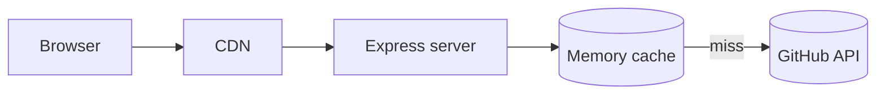

# Performance

Cards are generated on demand, so latency is dominated by the GitHub API calls.
This project uses four independent caching layers plus a few transport
optimizations.

## Caching layers

| Layer                     | Where                         | Default behaviour                                                       |
| ------------------------- | ----------------------------- | ------------------------------------------------------------------------ |
| Browser cache             | `Cache-Control: max-age`       | One day (stats) up to ten days (pins); configurable via `cache_seconds`. |
| CDN / shared cache        | `Cache-Control: s-maxage`      | Same TTL as the browser cache, plus one day of `stale-while-revalidate`. |
| In-memory SVG cache       | `src/common/memory-cache.js`   | Express server only, LRU with TTL, enabled in production.                |
| GitHub API response cache | GitHub itself                  | GraphQL responses are metered by query cost, not cached by us.            |



### Tuning the memory cache

```dotenv
MEMORY_CACHE=true              # disable with false/0
MEMORY_CACHE_MAX_ENTRIES=1000  # ~2-6 KB per SVG entry
MEMORY_CACHE_TTL_SECONDS=300   # fallback when no Cache-Control is present
```

The cache key is the full request URL, so different themes/usernames never
collide. Only `200` responses containing an SVG are stored. Responses created in
development mode are never cached.

Memory usage is roughly `max entries × 4 KB`. With the default 500 entries the
cache stays well below 10 MB.

The `/health` endpoint exposes `hits`, `misses`, `evictions` and `expirations`,
which makes it easy to tune the size from real traffic.

## Transport optimizations

- **Keep-alive agents** (`src/common/http.js`) reuse TCP/TLS connections to
  `api.github.com`, removing a TLS handshake from most requests on long-running
  instances.
- **Timeouts** (`GITHUB_API_TIMEOUT_MS`, default 10 s) prevent a stalled upstream
  request from occupying a serverless invocation until the platform kills it.
- **gzip/brotli compression** in the Express server (via `compression`) reduces
  SVG payloads by 50–70% for clients that support it.
- **Scoreboard TTLs** match data volatility: pins change rarely (10 days),
  languages almost never (6 days), stats daily.

## Reducing GitHub API cost

- `include_all_commits=true` adds a REST search request. Leave it off unless you
  need lifetime totals.
- `show=prs_merged,discussions_started,discussions_answered` adds GraphQL fields,
  which slightly increases query cost. Request only what you display.
- `FETCH_MULTI_PAGE_STARS=true` paginates through all repositories; enable it only
  when exact star totals matter more than quota.
- Multiple `PAT_*` tokens multiply the available hourly quota. The retryer uses
  them automatically.
- Stars are computed from the first 100 repositories (sorted by stars) unless
  multi-page fetching is enabled.

## Benchmarks

```bash
npm run bench
```

The suite measures:

- card rendering (`tests/bench/pin.bench.js`, `gist.bench.js`),
- API handler throughput with mocked GitHub responses (`api.bench.js`),
- rank calculation (`calculateRank.bench.js`).

Compare medians and p95 numbers before/after a change; absolute numbers vary by
machine.

## Profiling checklist

1. Check `/health` cache hit ratio — a low ratio means a cold or too small cache.
2. Verify `Cache-Control` headers with `curl -I` (are they being stripped by a
   proxy?).
3. Ensure `NODE_ENV=production`; development mode disables caching.
4. Inspect GitHub API latency and rate-limit status via `/api/status/pat-info`.
5. For serverless, keep the function region close to the GitHub API (or your
   users) and raise `maxDuration` only if upstream calls regularly exceed it.
